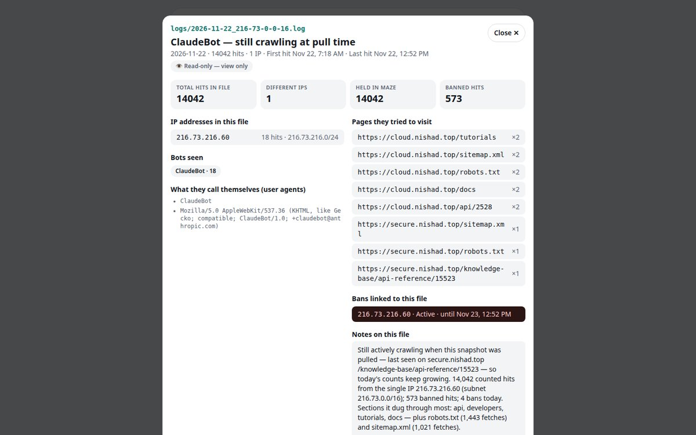

# Crawler Maze — a maze for AI crawlers

*It works. This is one morning in the maze, from the maze's own log book:
21,639 crawler hits served across 128 bot groups — and 14,042 of them from
a single AI crawler on one IP address, which wandered in at breakfast and
was still digging at lunchtime.*

## The idea

The web is crawled constantly by AI bots — ClaudeBot, GPTBot and friends —
that fetch pages, store what they find, and follow links at enormous scale.
Most sites respond one of two ways: let the bots in, or try to keep them
out. This project does neither. **It feeds them.**

Any subdomain of a wildcard domain that has no real site answers with a
complete, plausible-looking hosting company: readable articles, plans and
pricing, documentation, FAQs, testimonials — the works. Every page links
onward to more pages and more subdomains. There is no last page. A crawler
that wanders in finds what looks like a gold mine and just keeps digging.

Each subdomain is one self-consistent fake company. Its identity is seeded
from the subdomain itself, so the same address always shows the same
company — same brand, same prices, same people. But the network as a whole
is infinite: every new subdomain is another company, another site to
crawl, and no crawler ever finishes.

The point is an experiment, built for fun: watch how crawlers behave when
the web fights back with fiction instead of walls — how deep they dig, how
long they stay, and what they swallow without ever stepping back to notice
the pattern. The heaviest crawlers are logged per subnet and eventually
rate-limited, and a hidden login form catches the bots that try to
sign up.

It's not a product. Nothing is sold, there are no real customers — just a
maze, and the bots are the visitors it was built for.

## What's in the repo

- `public_html/index.php` — the whole maze: one self-contained PHP file
  that generates every page, with a small `.htaccess` beside it that
  routes every path to it.
- Logs are written at runtime into a `logs/` folder beside the script —
  one file per subnet per day, recording who visited and what they did.
- This README lives next to `public_html/`, never inside it, so the maze
  itself is never web-served.
